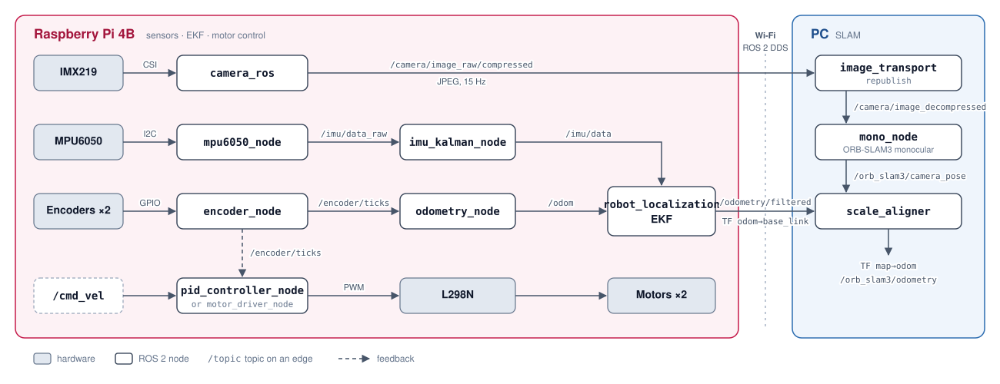
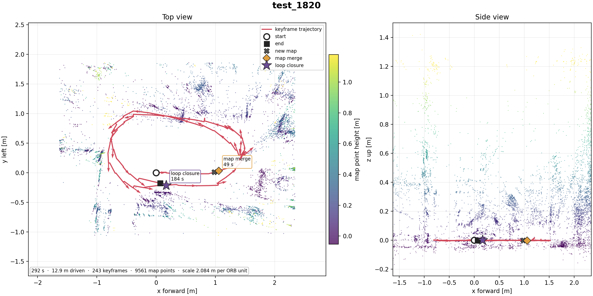
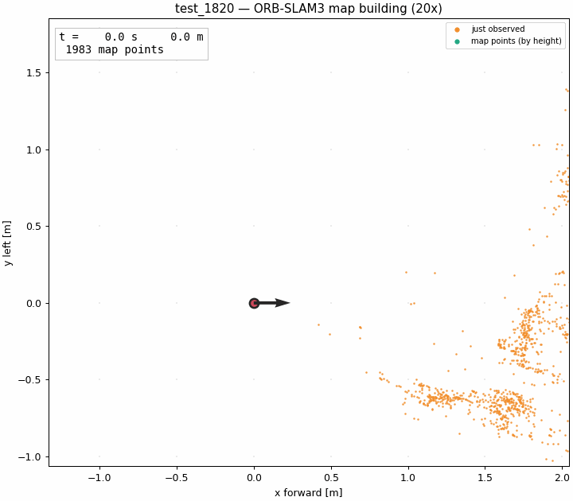

# Monocular Visual SLAM (ORB-SLAM3) for an RC Car

ROS 2 (Humble) workspace for a Raspberry Pi 4B differential-drive RC car.
Wheel encoders and an IMU are fused by an EKF into odometry, and a PC runs monocular
ORB-SLAM3 on the camera stream and gives it metric scale from the wheel odometry.

The Pi only publishes sensor data and drives the motors; all SLAM computation runs on the
PC. The two talk over ROS 2 DDS on the same Wi-Fi network.



## Hardware

| Item | Spec |
|---|---|
| Board | Raspberry Pi 4B 4GB, Ubuntu 22.04, ROS 2 Humble |
| Camera | IMX219 (Arducam), CSI, libcamera + hardware ISP. Mounted upright, tilted **20° up** → TF `base_link→camera_link` has `roll=0`, `pitch=-20°` |
| IMU | MPU6050 (GY-521), I2C bus 1 @ `0x68` |
| Motor driver | L298N |
| Encoders | 2× single-channel optical encoders (pulse count only, no direction) |
| Wheels | 65 mm diameter, 150 mm wheelbase, 40 pulses/rev (both edges) |

### GPIO pinout (BCM)

| Function | Pin |
|---|---|
| Left motor ENA / IN1 / IN2 | GPIO24 / GPIO22 / GPIO23 |
| Right motor ENB / IN3 / IN4 | GPIO25 / GPIO27 / GPIO26 |
| Left encoder | GPIO17 |
| Right encoder | GPIO16 |

> The L298N IN pins are wired opposite to the code's convention on both sides, so
> `left_invert` and `right_invert` are both `true`.

### TF frames

```
map ──(scale_aligner)──▶ odom ──(EKF)──▶ base_link ──┬──▶ camera_link ──▶ camera
                                               └──▶ imu_link
```

The `base_link` origin is the center of the rear axle; offsets are in
`rc_car_bringup/launch/sensor_tf.launch.py`. The IMU is mounted with x to the robot's right
and y forward, hence `yaw = -π/2`.

## Repository layout

```
orb-slam/
├── README.md
├── docs/                       # README figures, results of the test_1820 run
├── pyproject.toml              # ruff config
├── scripts/
│   └── build_third_party.sh    # builds ORB-SLAM3 + Pangolin (PC only, once before colcon)
├── src/
│   ├── imu_mpu6050/            # [Pi] MPU6050 driver + Kalman filter
│   ├── motor_encoder/          # [Pi] wheel encoder counts + wheel odometry
│   ├── pid_motor_controller/   # [Pi] closed-loop motor control (recommended)
│   ├── motor_controller/       # [Pi] open-loop motor control (run only one of the two)
│   ├── rc_car_bringup/         # [Pi] sensor stack, static TF, EKF
│   └── orb_slam/               # [PC] ORB-SLAM3 wrapper, SLAM launch files, RViz config
└── third_party/                # COLCON_IGNORE
    ├── ORB_SLAM3/              #   vendored upstream + local patches (see its README)
    └── Pangolin/               #   git submodule (v0.6)
```

The Pi and the PC use the same repository and branch. `orb_slam` skips itself at CMake time
when the ORB-SLAM3 library is missing, so `colcon build` on the Pi does not build SLAM.

## Packages

### `imu_mpu6050`
Reads the MPU6050 directly over I2C.

- **`mpu6050_node`** → `/imu/data_raw` (50 Hz), `/imu/temperature`
  - Re-estimates the gyro bias at every start while the robot is still (it drifts with temperature).
  - Corrects the accelerometer with `config/imu_calibration.yaml`: `a_corr = (a_raw - bias) * scale`.
  - Prints a health check comparing the resting `|a|` with 9.807 m/s².
- **`imu_kalman_node`** → `/imu/data`
  - A 2-state Kalman filter (angle + gyro bias) estimates roll/pitch and fills in the orientation.
  - There is no magnetometer, so yaw is integrated gyro and drifts; the EKF uses it in
    `differential` mode (changes only).
- **`scripts/calibrate_accel.py`** — accelerometer calibration ([below](#accelerometer-calibration)).

### `motor_encoder`
- **`encoder_node`** → `/encoder/ticks` (`Int32MultiArray [left, right]`, 50 Hz)
  - Counts both edges with GPIO interrupts and publishes **unsigned cumulative counts**.
- **`odometry_node`** → `/odom`
  - Integrates differential-drive kinematics.
  - The encoders have no direction, so each wheel's direction is taken from the sign of
    `/cmd_vel`. **If the car is pushed against the command (slip, external force), odometry
    gets the direction wrong.**
  - `publish_tf: false` by default because the EKF broadcasts the TF.

### `pid_motor_controller` (recommended, closed-loop)
- **`pid_controller_node`** — `/cmd_vel` + `/encoder/ticks` → PID → L298N PWM
  - Feed-forward (measured duty–speed linear model) plus PID correction.
  - Resets the integral term when the direction changes.
  - Stops if no `/cmd_vel` arrives for `cmd_timeout` (0.5 s), e.g. when Wi-Fi drops.
- **`step_cmd_vel_node`** — publishes step `/cmd_vel` commands for step-response tests.
- **`analyze_pid_step_response`** — computes rise time, overshoot, etc. from the controller's CSV log.

### `motor_controller` (alternative, open-loop)
- **`motor_driver_node`** — maps `/cmd_vel` straight to PWM duty, no encoder feedback.

> ⚠️ **Never run `pid_controller_node` and `motor_driver_node` at the same time.**
> They drive the same GPIO pins (ENA/ENB/IN1–4).

### `rc_car_bringup` (Pi)

| Launch | Contents |
|---|---|
| `sensors.launch.py` | camera + IMU + encoders/odometry + static TF + EKF (no motors) |
| `ekf.launch.py` | `robot_localization` EKF alone (`config/ekf.yaml`) |
| `sensor_tf.launch.py` | static TF `base_link` → `camera_link` / `camera` / `imu_link` |
| `intrinsic_calibration.launch.py` | camera intrinsic calibration (checkerboard) |

### `orb_slam` (PC only)
The ORB-SLAM3 monocular wrapper and everything needed to run SLAM.

| Launch | Contents |
|---|---|
| `slam.launch.py` | SLAM entry point: runs the three below |
| `slam_inputs.launch.py` | image decompression (`/camera/image_raw/compressed` → `/camera/image_decompressed`) |
| `slam_orbslam3.launch.py` | `mono_node` + `scale_aligner` |
| `rviz.launch.py` | RViz2 alone (`config/slam.rviz`) |

- **`mono_node`** — `/camera/image_decompressed` → `System::TrackMonocular`
  → `/orb_slam3/camera_pose`, `/orb_slam3/state`, `/orb_slam3/map_points`, service `~/save_map`
- **`scale_aligner`** — scales the monocular pose with `/odometry/filtered` and publishes
  `/orb_slam3/odometry` and TF `map → odom`.
- **`plot_map`** — plots a finished run ([below](#4-pc--plot-a-finished-run)).

## Build

**PC** (once, then whenever `third_party/` changes):

```bash
git clone --recursive git@github.com:JINWOOSEO21/monocular-visual-SLAM.git
cd monocular-visual-SLAM
./scripts/build_third_party.sh      # Pangolin → DBoW2 → g2o → ORB_SLAM3, unpacks the vocabulary
```

**PC and Pi:**

```bash
colcon build --symlink-install
source install/setup.bash
```

`build_third_party.sh` fetches the Pangolin submodule if it is missing and unpacks the
vocabulary to `~/.ros/orbslam3/ORBvoc.txt`. The local ORB-SLAM3 patches are described in
[`third_party/ORB_SLAM3/README.md`](third_party/ORB_SLAM3/README.md).

Dependencies: `sudo apt install ros-humble-camera-ros ros-humble-robot-localization ros-humble-image-transport`,
Python `RPi.GPIO`, `smbus`, `PyYAML` (Pi).

## Running

### 1. Pi — sensor stack

```bash
ros2 launch rc_car_bringup sensors.launch.py      # camera 15 Hz / JPEG q80
```

### 2. Pi — motor control (separate terminal, only one of the two)

```bash
ros2 launch pid_motor_controller pid_controller.launch.py   # closed-loop (recommended)
# or
ros2 launch motor_controller motor.launch.py                 # open-loop
```

### 3. PC — SLAM + visualization

```bash
ros2 launch orb_slam slam.launch.py
```

This starts image decompression, ORB-SLAM3 and RViz2 together.

```
Pi: sensors + EKF ──▶ /camera/image_raw/compressed, /odometry/filtered, TF odom→base_link
                          │
PC: slam_inputs ──▶ /camera/image_decompressed
                          │
    mono_node ──▶ /orb_slam3/camera_pose (unscaled)
                          │
    scale_aligner ──▶ /orb_slam3/odometry, TF map→odom
```

| Argument | Default | Description |
|---|---|---|
| `rviz` | `true` | RViz2 (`config/slam.rviz`) |
| `use_sim_time` | `false` | `true` when replaying a rosbag (`ros2 bag play <bag> --clock`) |
| `mode` | `slam` | `slam` / `localization` |
| `vocabulary` | `~/.ros/orbslam3/ORBvoc.txt` | BoW vocabulary |
| `settings_path` | (package `config/imx219_820x616.yaml`) | camera / ORB settings |
| `atlas_path` | `~/.ros/orbslam3/atlas` | Atlas save/load path |
| `use_viewer` | `false` | ORB-SLAM3's own Pangolin viewer |
| `trajectory_path` | `~/.ros/orbslam3/kf_trajectory.txt` | keyframe trajectory (TUM) written on shutdown |
| `map_points_path` | `~/.ros/orbslam3/map_points.ply` | map points (ASCII PLY: `x y z observations t_first`) written on shutdown |
| `scale_path` | `~/.ros/orbslam3/scale.yaml` | per-map scale from `scale_aligner`, written on shutdown (read by `plot_map`) |

Raw images drop to ~17 fps over Wi-Fi, so the Pi sends only compressed images and the PC
decompresses them with `image_transport/republish`. Loop closure only happens when the car
passes the same place **in the same direction**, so drive test loops in one direction.

### 4. PC — plot a finished run

Stopping SLAM with Ctrl-C saves the current map's keyframe trajectory, map points and
scale (`scale.yaml`) to `~/.ros/orbslam3/`. To create the static figure, the driving
animation and the 3D viewer:

```bash
ros2 run orb_slam plot_map --name <run> --events ~/.ros/log/<run log dir>/launch.log
```

- Writes `<run>_map.png`, `<run>_run.gif` and `<run>_viewer.html` next to the trajectory
  file (`--outdir` to change). The HTML page opens directly in a browser.
- The scale (m per ORB unit) is read from `scale.yaml` next to the trajectory file; pass
  `--scale <s>` to override it.
- `--events` (optional) marks new map / map merge / loop closure on all three.
- The next run overwrites `kf_trajectory.txt` / `map_points.ply` / `scale.yaml`; copy them
  together to keep a run and pass them with `--trajectory` / `--points`.

## Calibration

### Accelerometer calibration

The MPU6050 on this car reads `|a| = 11.16 m/s²` at rest (+13.9% over 9.807), so the
accelerometer needs per-axis bias and scale. On a flat table:

```bash
python3 src/imu_mpu6050/scripts/calibrate_accel.py
```

Follow the prompts to hold the IMU in six orientations (each axis up and down). The result
is saved to `src/imu_mpu6050/config/imu_calibration.yaml` and applied the next time
`mpu6050_node` starts; the log should then show `Gravity check OK: |a|=9.8xx m/s²`.

## Results

`test_1820` (2026-10-13): one indoor loop driven slowly with the camera tilted 20° up.
ORB-SLAM3 lost tracking once, started a new map and merged it back into the first map a
second later (49 s). When the car came back to the start, it **detected the loop and
closed it** (184 s), and the global bundle adjustment corrected the whole trajectory.

| Duration | Distance | Keyframes | Map points | Map merge | Loop closure |
|---|---|---|---|---|---|
| 292 s | 12.9 m | 243 | 9,610 | 1 (49 s) | 1 (184 s) |

- Scale: 2.084 m per ORB unit, from `scale_aligner` (wheel + IMU odometry).
- The camera tilt estimated from the trajectory is 19.8° (TF: 20°), and the keyframe height
  varies by 2 mm (std) after leveling, as expected on a flat floor.





The animation replays the final, loop-closed map; each map point appears when it was first
observed. The interactive 3D viewer is
[`docs/test_1820/test_1820_viewer.html`](docs/test_1820/test_1820_viewer.html) — download it
and open it in a browser (GitHub shows HTML files as source).
